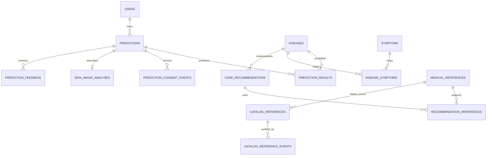

# MediPredict initial database schema

**Status:** Initial ORM schema drafted on the `develop` branch. This document describes the
persistence design; it is not a clinical data standard or a claim of production readiness.

## Design goals

- Keep text and skin-image analysis independently usable.
- Keep each prediction request separate from its ranked candidate results.
- Allow guest predictions while supporting an optional registered account.
- Keep uploaded image bytes outside PostgreSQL; store only a private object-storage key and
  verification metadata in the database.
- Do not store raw symptom text by default. Persist it only after explicit, purpose-specific
  history-storage consent has been captured.
- Preserve model version and disclaimer version so later reviews can identify the system version
  that produced a result.
- Treat prediction output as decision support, never as a confirmed diagnosis.

## Entity relationship overview

## Tables

| Table | Purpose | Important fields |
|---|---|---|
| `users` | Registered accounts | UUID, unique email, password hash, display name, timestamps |
| `diseases` | Curated supported-condition catalog | stable code, name, description, active flag |
| `symptoms` | Normalized symptom catalog | stable code, name, review status, reviewer and timestamp |
| `disease_symptoms` | Many-to-many catalog mapping | disease ID, symptom ID, relevance weight |
| `predictions` | One analysis request and lifecycle | optional user, modality, status, consent flag, model/disclaimer versions |
| `prediction_consent_events` | Consent decision audit | prediction, purpose, granted/revoked action, policy version, capture timestamp |
| `prediction_results` | Ranked candidate conditions | prediction, disease, rank, probability field, explanation |
| `skin_image_analyses` | Metadata for image analysis | private object key, MIME type, SHA-256, class, confidence, quality/review flags |
| `prediction_feedback` | Feedback about usefulness | prediction, helpful flag, comment, review status |
| `medical_references` | Versioned source provenance | publisher, URL, evidence type, version, review status, reviewer |\n| `medical_reference_events` | Immutable source lifecycle audit | registration/review event, previous/new status, actor, reason, timestamp |
| `care_recommendations` | General-care information | disease, locale, category, urgency, version, approval and validity |
| `recommendation_references` | Recommendation-to-source links | recommendation ID, reference ID, reviewer note |
| `catalog_references` | Current source links for catalog entries | target type/key, reference ID, linking actor/reason, soft-removal metadata |
| `catalog_reference_events` | Immutable catalog source-link history | link, source, target, linked/removed action, actor, reason, timestamp |
| `catalog_reviewer_scopes` | Current reviewer access grants | reviewer, catalog type/key, grant and revocation metadata |
| `catalog_reviewer_scope_events` | Immutable reviewer-scope audit | grant/revoke event, reviewer, operator, scope, reason, timestamp |

## Prediction history API

Authenticated history endpoints are mounted under `/api/v1/predictions/history`:

- `GET /` lists only the signed-in user's records, with bounded pagination. Response schemas
  deliberately omit raw symptom text, image object keys and other free-text health inputs.
- `POST /{prediction_id}/revoke-consent` currently supports text-only history. It clears the
  retained symptom narrative, removes associated ranked result details, and appends a versioned
  revocation event. It does not delete the prediction's minimal audit metadata.
- `DELETE /{prediction_id}` deletes an owned history item only when no external skin-image object
  needs cleanup. It returns a conflict for image-backed records until an object-storage deletion
  adapter exists. This avoids falsely reporting deletion while a private image might remain.

All operations require a valid active-user bearer token and filter by both prediction ID and
authenticated owner. An unknown ID and another user's ID produce the same not-found response.
The history API does not create predictions; a separate inference workflow must explicitly
capture a grant event before persisting health text.

## Key rules

### Prediction lifecycle and consent

- `modality` is restricted to `text`, `skin_image`, or `combined`.
- `status` is restricted to `pending`, `completed`, `failed`, or `review_required`.
- A guest request may have a null `user_id`; account deletion and guest-history deletion need explicit service workflows.
- `combined` is a storage capability only. It does not imply clinically validated multimodal fusion.
- Raw `input_text` must be null unless `input_storage_consent=true`; a database check constraint enforces this invariant.
- The consent-event table records the purpose (`prediction_history`), action (`granted` or `revoked`), policy version and timestamp. It is an audit record, not a substitute for an explicit UI action.
- A service must verify a matching grant event before writing health text or retaining history. A boolean alone is never proof of consent.
- Revocation must stop future storage and remove retained text and result details. Current API supports text-only revocation; image/combined revocation waits for verified object deletion.
- History is not created automatically by the symptom-normalization endpoint. Users must be able to use symptom analysis without an account or saved history.
- Do not store raw symptom text, uploaded image bytes, or user-entered free text in application logs, analytics, traces, or error reports.
- A retention period, scheduled purge, export flow, backup expiry, and guest-session ownership mechanism must be defined before history is enabled broadly. These workflows are not yet implemented.
- A deletion request must remove linked prediction results, feedback, consent events and private image objects as applicable; database cascades alone cannot delete external object-storage files or backups.

### Symptom catalog publication

- The packaged `/symptoms/catalog` taxonomy is research vocabulary and remains explicitly unvalidated.
- The database-backed `/catalog/symptoms` endpoint is a separate curated publication channel.
- A database symptom is public only when `is_active=true` and `review_status='approved'`.
- Approval requires both a non-empty reviewer identifier and a review timestamp.
- Draft, in-review, retired and inactive symptoms are excluded from public search and pagination counts.
- No research taxonomy entries are automatically copied into the reviewed database catalog.
- A qualified reviewer must independently verify terminology, definition, scope and suitability before approving a record. No reviewer UI or clinical approval is claimed.

### Catalog source-reference governance

- Catalog source links use the existing versioned `medical_references` registry; they do not
  create a second source catalogue.
- A link identifies a disease, symptom, or disease-symptom relation by stable target type/key
  and points to an existing medical-reference version.
- Link creation and removal require an active reviewer scope and a reason of at least eight
  non-whitespace characters.
- Link removal is soft removal. Re-linking a previously removed source reactivates the
  association while retaining prior immutable link/remove events.
- Source records are created by administrators and always start in `draft`. Attachment does
  not change source review state.
- Inspection displays publisher, URL, evidence type, version, publication/access dates, source
  review state, review due date, and link reason.
- Source attachment is provenance metadata, not clinical proof. The public knowledge endpoint
  continues to require an approved, current source independently of catalog review status.

### Reviewer scope governance

- Reviewer role provisioning does not automatically grant catalog access.
- Each reviewer must receive an explicit scope for diseases, symptoms, or disease-symptom relationships.
- A null scope key grants the full selected category; a non-null key grants one exact catalog code or `DISEASE_CODE:SYMPTOM_CODE` relationship.
- The API checks active assignments for both queue visibility and each review decision. Revoked grants no longer authorize access.
- Only administrators can grant or revoke scopes. The target must be an active, email-verified reviewer account.
- Every grant and revocation requires a reason and creates an immutable event in the same transaction as the current assignment change.
- Reviewers can inspect only their own catalog decision history; administrators can inspect the full history and scope audit.
- This is operational access control, not evidence that a reviewer is clinically qualified. Qualification and scope must be verified outside the application.

### Skin-image privacy and quality

- Image bytes must be stored in private object storage, never in a database binary column.
- `object_key` must not be a public URL. Access must be mediated by an authorized backend route or short-lived signed URL.
- Validate file size, MIME type, actual file signature, and image decodability before inference.
- Reject unsupported formats and poor-quality or out-of-scope images; mark uncertain cases for clinician review.
- Define retention and deletion behavior for both the object and its metadata before enabling uploads.

### Account security

- `password_hash` must contain a modern password hash (for example Argon2id), never a plaintext or reversible password.
- Authentication, email verification, rate limiting, and account recovery are separate application-layer work.
- Do not log passwords, raw health text, image object keys, or secrets.

### Medical safety and governance

- Prediction candidates are not diagnoses and must be presented with uncertainty and a clear clinician-review message.
- No medication or dosage advice is stored or generated by these tables.
- Public care information is served only when the recommendation is active, approved, within its validity dates, and linked to at least one approved medical reference.
- Medical references retain publisher, URL, evidence type, version, access date and review status. Recommendation versions retain locale, category, urgency, reviewer and validity dates.
- Draft and in-review material is not exposed by the public knowledge endpoint. The endpoint returns general education only, not diagnosis or treatment plans.
- Feedback is a usefulness signal, not proof of a diagnosis or clinical outcome.

## Deliberately deferred

Automatic retention jobs, image-object deletion adapter, user export, full account deletion, chat sessions/messages,
and model registry/evaluation runs remain deferred. They need their own access-control, provenance,
threat-model and operational decisions before use.

## ORM source

- `backend/app/models/user.py`
- `backend/app/models/catalog.py`
- `backend/app/models/prediction.py`
- `backend/app/models/feedback.py`
- `backend/app/models/knowledge.py`
- `backend/app/models/reviewer_scope.py`
- `backend/app/models/catalog_reference.py`
- `backend/app/models/__init__.py`

Alembic migrations through `0013_catalog_references.py` extend the initial schema, including
catalog approval governance, reviewer roles, scoped reviewer access, and audited catalog source links. They are
committed to the development branch and validated through the automated PostgreSQL test workflow;
they have not been applied to a production database.
