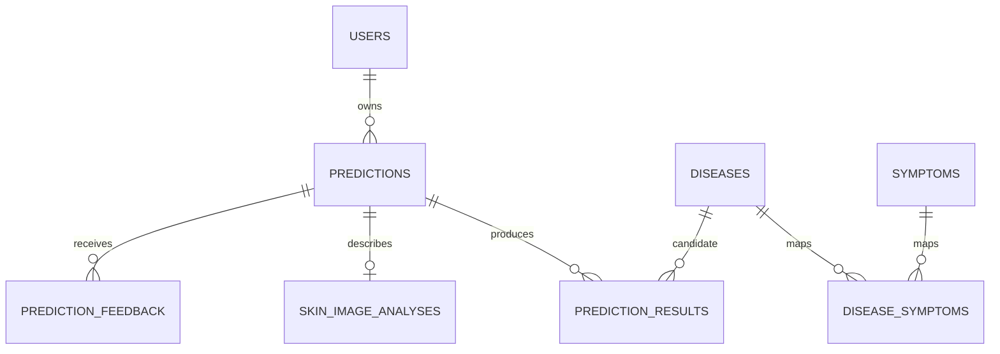

# MediPredict initial database schema

**Status:** Initial ORM schema drafted on the `develop` branch. This document describes the
first persistence layer; it is not a clinical data standard or a claim of production readiness.

## Design goals

- Keep text and skin-image analysis independently usable.
- Keep each prediction request separate from its ranked candidate results.
- Allow guest predictions while supporting an optional registered account.
- Keep uploaded image bytes outside PostgreSQL; store only a private object-storage key and
  verification metadata in the database.
- Store symptom input text only when the user has explicitly consented to history storage.
  The API/service layer must enforce this rule; a database boolean alone is not consent.
- Preserve model version and disclaimer version so later reviews can identify the system version
  that produced a result.
- Treat prediction output as decision support, never as a confirmed diagnosis.

## Entity relationship overview

## Tables in the first schema

| Table | Purpose | Important fields |
|---|---|---|
| `users` | Registered accounts | UUID, unique email, password hash, display name, timestamps |
| `diseases` | Curated supported-condition catalog | stable code, name, description, active flag |
| `symptoms` | Normalized symptom catalog | stable code, unique name, description, active flag |
| `disease_symptoms` | Many-to-many catalog mapping | disease ID, symptom ID, relevance weight |
| `predictions` | One analysis request and lifecycle | optional user, modality, status, consent flag, model/disclaimer versions |
| `prediction_results` | Ranked candidate conditions | prediction, disease, rank, probability field, explanation |
| `skin_image_analyses` | Metadata for image analysis | private object key, MIME type, SHA-256, class, confidence, quality/review flags |
| `prediction_feedback` | Feedback about usefulness | prediction, helpful flag, comment, review status |

## Key rules

### Prediction lifecycle

- `modality` is restricted to `text`, `skin_image`, or `combined`.
- `status` is restricted to `pending`, `completed`, `failed`, or `review_required`.
- A guest request may have a null `user_id`; account deletion should not erase aggregate monitoring evidence by accident.
- `combined` is a storage capability only. It does not imply clinically validated multimodal fusion.
- Ranked result probabilities are constrained to the inclusive range 0–1. Their interpretation and calibration must be validated by the ML evaluation pipeline.

### Skin-image privacy and quality

- Image bytes must be stored in private object storage, never in a database binary column.
- `object_key` must not be a public URL. Access must be mediated by an authorized backend route or short-lived signed URL.
- Validate file size, MIME type, actual file signature, and image decodability before inference.
- Reject unsupported formats and poor-quality or out-of-scope images; mark uncertain cases for clinician review.
- Define retention and deletion behavior for both the object and its metadata before enabling uploads.

### Account security

- `password_hash` must contain a modern password hash (for example Argon2id), never a plaintext or reversible password.
- Authentication, email verification, rate limiting, and account recovery are separate application-layer work and are not implemented by these models.
- Do not log passwords, raw health text, image object keys, or secrets.

### Medical safety and governance

- Prediction candidates are not diagnoses and must be presented with uncertainty and a clear clinician-review message.
- No medication or dosage advice is stored or generated by these tables.
- Medical recommendations must be grounded in separately reviewed references with source/version tracking; that reference and recommendation schema is a later milestone.
- Feedback is a usefulness signal, not proof of a diagnosis or clinical outcome.

## Deliberately deferred tables

The first ORM pass does not yet implement medical references, care recommendations, generated reports,
chat sessions/messages, audit events, consent receipts, model registry/evaluation runs, or admin roles.
These need their own retention, access-control, provenance, and threat-model decisions before schema
implementation.

## ORM source

- `backend/app/models/user.py`
- `backend/app/models/catalog.py`
- `backend/app/models/prediction.py`
- `backend/app/models/feedback.py`
- `backend/app/models/__init__.py`

Alembic migrations have not yet been generated or applied. The ORM definitions are a draft until
migration review and automated tests are completed.
